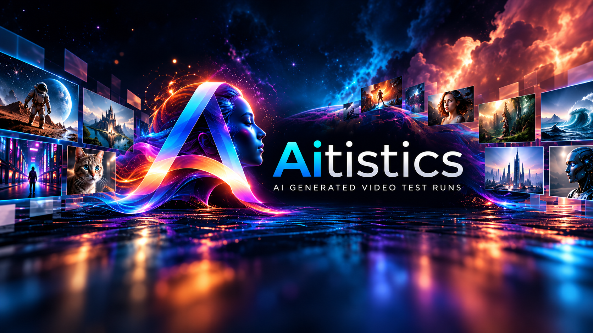

# Aitistics

Aitistics documents practical test runs of AI-generated video tools, models, workflows, and generation techniques. This repository is an experiment archive. Rendered videos are published externally on YouTube; representative frames, original configuration/settings, and metadata are preserved here where practical.

## Current tests

| System | Archive |
| --- | --- |
| Deforum | [Deforum test runs](runs/deforum/README.md) |

## Archive structure

Runs live under `runs/<system>/<number>-<test-name>/`. Each system has an independent numbering sequence. Each run contains a README, metadata.yaml, original settings under config/, and representative frames under images/.

Additional generation systems will live adjacent to deforum under runs/ when actual runs exist.

## Recording a run

1. Create the next numbered run directory within the relevant system.
2. Adapt the [run README](templates/run-readme.md) and [metadata](templates/metadata.yaml) templates.
3. Preserve available original settings and representative frames with their source filenames.
4. Add the published YouTube URL and update the system index.
5. Review relative links and check for private paths and sensitive information before committing.

Keep rendered video outputs outside Git. Images are ordinary Git files; Git LFS is not used.

See the [methodology](docs/methodology.md) for recording principles.

## Licence

No licence has been selected for this archive.
