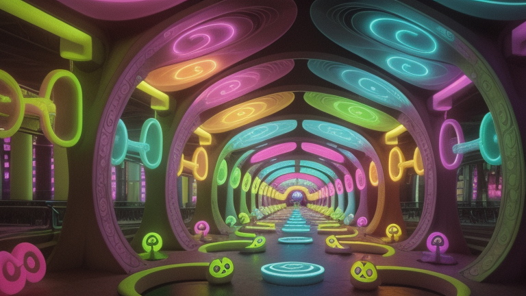
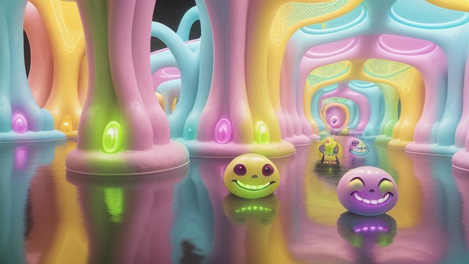
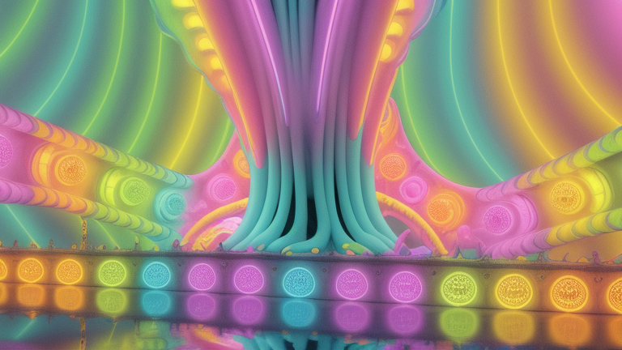
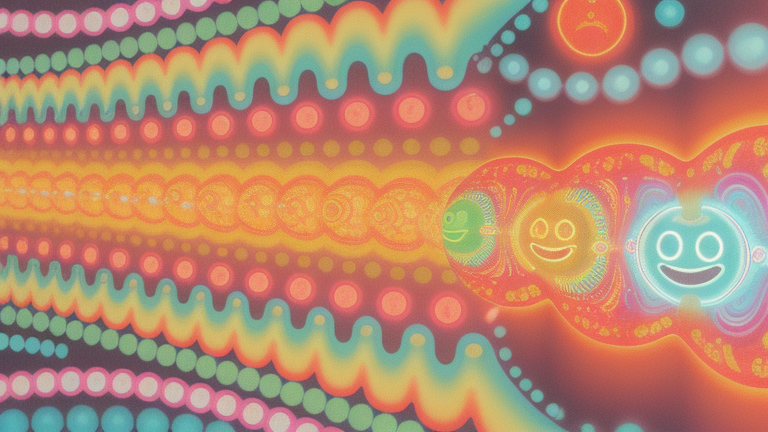
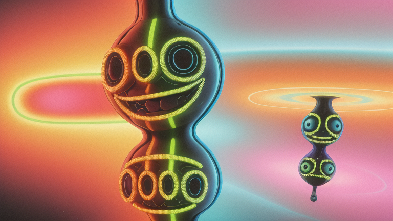

# 001 — Smiley Art

Generator: **Deforum**

## Video

[Watch the completed video on YouTube](https://youtu.be/JHh2gOb6LOk).

## Overview

A Deforum test using smiley-themed psychedelic environment prompts. These screenshots are representative frames from the test render.

## Generation details

These are configured settings, not independently measured properties of the published video.

| Setting | Value |
| --- | --- |
| Model | dreamshaper_8.safetensors |
| Model hash | 879db523c3 |
| Resolution | 768 x 432 |
| FPS | 15 |
| Maximum frames | 2000 |
| Base seed | 132457 |
| Seed behaviour | schedule |
| Sampler | Euler a |
| Steps | 22 |
| Animation mode | 3D |

The seed changes according to the schedule in the configuration and metadata. The date is inferred from original filenames. Software versions and hardware are not recorded in the supplied files.

## Configuration

[Original Deforum configuration](config/20261024023625_smiley_art_deforum.txt) · [Metadata](metadata.yaml)

The original configuration is preserved byte for byte.

## Example frames

